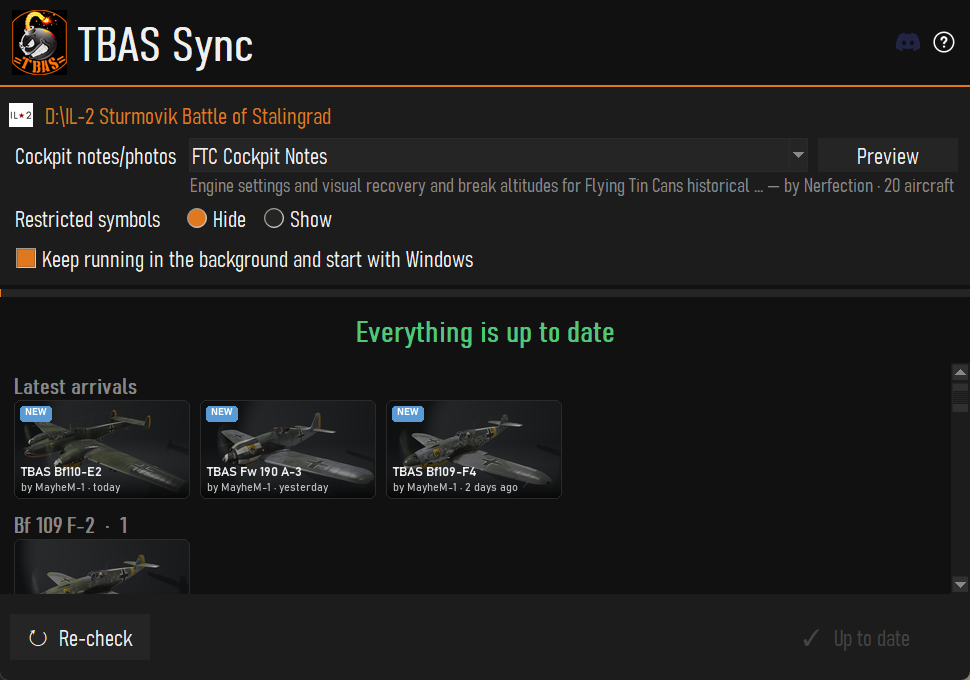

# TBASSync

TBASSync is a desktop tool for **IL-2: Great Battles** players that downloads
and installs skin packs from the [HSD](https://hsd-online.net) website and
keeps your local skins folder in sync with the collections you subscribe to.

It is a rebranded fork of [IL2GB-HSDSync](https://github.com/RaphED/IL2GB-HSDSync),
which is itself a fork of the original
[Inter-Squadrons Skins Synchronizer (ISS)](https://github.com/RaphED/IL2GB-inter-squadrons-skins-synchronizer)
by RaphED, adapted for HSD v2 by IRRE_Fizz and Haluter.



## Installation

Download `TBASSync-Setup.exe` from the
[Releases](https://github.com/riaanjutte/TBASSync/releases) page and run it.
It installs for your Windows account only (no admin prompt) into
`%LOCALAPPDATA%\Programs\TBAS Sync` and adds a Start Menu shortcut.

TBAS Sync isn't code-signed, so Windows SmartScreen may say "Windows protected
your PC". Click **More info**, then **Run anyway**.

**Moving from the zip:** quit the old TBAS Sync (tray icon > Quit), run Setup,
then delete your old `TBASSync.exe`. Your settings in `%APPDATA%\TBASSync\` are
kept, and the installed copy takes over starting with Windows the first time it
runs.

**Uninstalling:** Windows Settings > Apps > Installed apps > TBAS Sync >
Uninstall. Your settings in `%APPDATA%\TBASSync\` are left in place; delete that
folder too if you want them gone.

**Portable zip:** prefer no installer? `TBASSync.zip` on the same page still
works. Extract it somewhere permanent (Desktop, `Documents`, a dedicated tools
folder — not the zip itself, and not `Program Files`), and run `TBASSync.exe`.

See [`releaseAssets/README.txt`](releaseAssets/README.txt) for the full
end-user guide that ships inside the zip.

## Where settings live

Config, logs, and caches are stored under:

```
%APPDATA%\TBASSync\
```

- `TBASSync-config.json` — user configuration
- `TBASSync-subscriptions.json` — subscribed collections
- `TBASSync-hashes.json` — cached file checksums
- `TBASSync.log` — latest log (attach this when reporting issues)
- `temp\` — scratch downloads

## Building from source

Requires Windows, Python 3.11+, and PowerShell.

```powershell
py -m venv venv
.\venv\Scripts\Activate.ps1
pip install -r requirements.txt
.\buildRelease.ps1
```

`TBASSync.exe`, `TBASSync.zip` and the installer `TBASSync-Setup.exe` are
emitted under `release\`. The installer needs
[Inno Setup 6](https://jrsoftware.org/isdl.php); without it the build skips
Setup with a warning (on CI it fails).

To run the app directly from source:

```powershell
python main.py          # normal mode
python main.py -debug   # verbose logging
```

## Project layout

```
GUI/          Tkinter UI (main window, panels, modals, splash, updater)
Services/    Core logic: config, scanning, sync, HSD API client, updater
Resources/   Icons, splash screens, app icon
releaseAssets/  Files copied into the release zip (end-user README)
installer/      Inno Setup script for TBASSync-Setup.exe
buildRelease.ps1   PyInstaller build driver
TBASSync.spec      PyInstaller spec
```

## Contributing

Issues and PRs are welcome — see
[`.github/ISSUE_TEMPLATE`](.github/ISSUE_TEMPLATE) and
[`.github/PULL_REQUEST_TEMPLATE.md`](.github/PULL_REQUEST_TEMPLATE.md).

## License

No explicit license is declared yet. The upstream project
[`RaphED/IL2GB-HSDSync`](https://github.com/RaphED/IL2GB-HSDSync) also ships
without a `LICENSE` file, so the original code is under default copyright to
its authors (RaphED, IRRE_Fizz, Haluter). Contact the upstream authors before
redistributing or relicensing.

## Credits

- **TBASSync rebrand / maintenance** — riaanjutte
- **HSDSync (upstream fork)** — IRRE_Fizz, Haluter
- **ISS (original)** — RaphED
- **HSD website & API** — the HSD team
